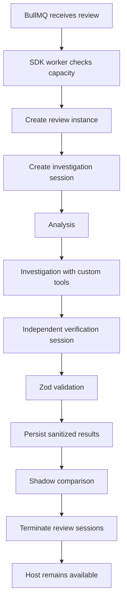

# OpenCode SDK Review Runtime — Final Architecture Decision Record

**Status:** Architecture agreed (40/40 decisions). Phase 0 approved; production rollout **not authorized**.
**Branch:** `experiment/opencode-sdk-runtime`
**Supersedes:** none. Complements `docs/architecture.md`; the existing CLI runtime remains the production path.
**Date:** 2026-11-11

---

## 1. Architectural objective

Introduce the OpenCode SDK as an experimental runtime to improve:

1. **Review quality** through persistent investigation sessions.
2. **Efficiency** through reduced repeated prompt construction and better context continuity.
3. **Extensibility** through custom review tools and plugins.

The SDK is **not** intended to replace the review engine or take ownership of GitHub publishing.

The project is best described as:

> Building a session-oriented review runtime with OpenCode as its execution engine, while retaining application ownership of security, review policy, validation and publishing.

It is **not** "integrating the OpenCode SDK into the existing reviewer."

---

## 2. Target architecture

```text
GitHub webhook
   ↓
Probot → durable ingestion → Postgres → outbox
   ↓
BullMQ review queue
   ↓
┌──────────────────────────────┬──────────────────────────────────────┐
│ CLI workers (production)     │ SDK workers (experimental)           │
│ Existing runtime, unchanged  │ Dedicated container deployment        │
│                              │ SDK worker process                   │
│                              │ One long-lived OpenCode host/process  │
│                              │  ├─ Review A: isolated instance +    │
│                              │  │            investigation session  │
│                              │  └─ Review B: isolated instance +    │
│                              │               investigation session  │
│                              │ Independent review-scoped budgets    │
│                              │ and tool closures                    │
└──────────────────────────────┴──────────────────────────────────────┘
   ↓
Application-owned review engine
Analysis → SDK-driven investigation → independent verification → Zod validation
   ↓
Existing persistence and publishing pipeline
SDK shadow results initially; CLI remains publisher
```

**Important:** separate sessions and instances are *logical* isolation, not automatically a hard security boundary. The container boundary and permission tests are mandatory.

---

## 3. Repository structure

The existing runtime interface remains the abstraction boundary.

```text
src/
├── agent/
│   ├── types.ts                (AgentRuntime contract)
│   ├── opencode-runtime.ts
│   ├── opencode-sdk-runtime.ts
│   │
│   ├── sdk/
│   │   ├── host-manager.ts
│   │   ├── session-manager.ts
│   │   ├── instance-manager.ts
│   │   ├── lifecycle.ts
│   │   └── health.ts
│   │
│   ├── config/
│   │   ├── runtime-config.ts
│   │   ├── opencode-config.ts
│   │   └── sdk-config.ts
│   │
│   └── plugins/
│       ├── review-tools.ts
│       ├── review-audit.ts
│       └── review-metrics.ts
│
├── review-engine/
│   ├── engine.ts
│   ├── plan.ts
│   ├── tools.ts
│   ├── budget.ts
│   └── prompts/
│
├── worker.ts                   (existing CLI worker entrypoint)
├── worker/
│   └── sdk-worker.ts           (new; dedicated SDK worker, Phase 1+)
│
└── publishing/
    └── ... existing implementation
```

This is a target structure, not a claim that these directories already exist. Adapt it to actual repository conventions.

### Runtime contract

Keep the existing `AgentRuntime` interface wherever possible. The SDK implementation exposes the same lifecycle:

```ts
interface AgentRuntime {
  startSession(options: SessionOptions): Promise<AgentSession>;
  execute(session: AgentSession, request: ExecuteRequest): Promise<ExecuteResult>;
  terminate(session: AgentSession): Promise<void>;
  healthCheck(): Promise<RuntimeHealth>;
}
```

Exact signatures follow the existing code (`src/agent/types.ts`) rather than introducing unnecessary interface churn.

---

## 4. SDK host and review lifecycle



Host lifecycle:

- Start once when the SDK worker starts.
- Reuse across reviews.
- Track active review instances.
- Create a fresh investigation session per review.
- Create a fresh verification session.
- Clean up review-scoped resources in `finally`.
- Gracefully recycle the host when resource thresholds are reached.
- Close the host during worker shutdown.

**Key distinction:** the review session is disposable; the host is long-lived.

---

## 5. Configuration design

Keep the CLI configuration intact and introduce an SDK-specific section.

```json
{
  "agent": {
    "runtime": {
      "type": "opencode-cli"
    },
    "sdk": {
      "enabled": false,
      "maxConcurrentReviews": 2,
      "maxSessionsPerHost": 4,
      "maxHostLifetimeReviews": 100,
      "maxHostRssMb": 2048,
      "gracefulShutdownMs": 30000,
      "shadowMode": true
    }
  }
}
```

These values are starting examples, not production-approved resource limits.

The schema must include:

- Runtime selection.
- Host lifecycle.
- Resource limits.
- Provider configuration.
- Plugin configuration.
- Session timeout.
- Review execution budgets.
- Shadow-mode settings.

Use one canonical internal configuration model with separate CLI and SDK serializers.

### Provider configuration

Initially preserve:

- Existing GLM model.
- Existing OpenAI-compatible endpoint.
- Existing API key environment variable.
- Existing sampling and output constraints.

The SDK worker receives only the credentials it needs. It must **not** receive `GITHUB_TOKEN` or unrestricted GitHub installation credentials.

---

## 6. Plugin and tool design

### Global plugins

- Existing Langfuse observability integration, after compatibility verification.
- Application metrics.
- Application audit instrumentation.

### Review-scoped tools

| Tool | Initial status |
| --- | --- |
| `review_read_file` | Existing capability |
| `review_list_files` | Existing capability |
| `review_get_diff` | Existing capability |
| `review_search_code` | New capability |
| `review_get_related_tests` | Deferred |

Tools must call trusted application services, never directly implement unrestricted filesystem access.

### Tool execution contract

```ts
interface ReviewToolContext {
  reviewId: string;
  workspacePath: string;
  retrievalBudget: RetrievalBudget;
}

interface ReviewToolResult {
  path: string;
  content: string;
  startLine?: number;
  endLine?: number;
  truncated: boolean;
  bytesReturned: number;
}
```

**Never** accept a workspace path or review identity from model-supplied arguments. Resolve these through the trusted review-scoped context.

---

## 7. Security architecture

### Release-blocking requirements

1. Separate SDK worker deployment.
2. Restricted filesystem mounts.
3. No access to other review workspaces.
4. No unrestricted GitHub credentials.
5. Restricted outbound networking.
6. Application-enforced retrieval budgets.
7. Path traversal and symlink protections.
8. Workspace integrity verification.
9. Session-level separation.
10. Host lifecycle cleanup.

### Mandatory adversarial tests

- Source-code prompt injection.
- README prompt injection.
- Malicious symlinks.
- Environment-file access.
- Cross-review workspace access.
- Unauthorized file creation.
- Modification of tracked files.
- Deletion of existing files.
- Out-of-workspace writes.
- Concurrent session interference.

The existing `git status --porcelain` integrity guard must remain.

Remember: that guard detects modifications **after** execution; it does not prevent them. SDK permission enforcement must be independently demonstrated.

---

## 8. Review execution and budgets

Keep the existing tier-based review planning. Introduce separate limits:

```ts
interface ReviewExecutionBudget {
  maxModelRequests: number;
  maxToolCalls: number;
  maxInvestigationRounds: number;
  maxInputTokens: number;
  maxOutputTokens: number;
  maxRetrievalBytes: number;
  maxDurationMs: number;
}
```

- The application owns enforcement.
- The SDK owns session continuity and model/tool orchestration.
- The verifier gets a separate session with candidate findings and supporting evidence, **not** the investigator's conversation history.
- Automatic compaction must preserve evidence, unresolved questions, file references and review constraints.

---

## 9. Observability

Retain the existing Langfuse plugin where compatible. Add application-level measurements:

| Metric | Purpose |
| --- | --- |
| `sdk.host.create_ms` | Host initialization |
| `sdk.host.rss_bytes` | Memory consumption |
| `sdk.session.create_ms` | Session initialization |
| `sdk.model.requests` | Model request count |
| `sdk.tool.executions` | Tool usage |
| `sdk.retrieval.bytes` | Retrieval consumption |
| `sdk.review.duration_ms` | Total execution time |
| `sdk.review.failures` | Failure classification |
| `sdk.host.recycles` | Host lifecycle health |

Also capture session compaction and model request metadata. Avoid duplicating Langfuse tracing.

---

## 10. Failure handling

| Failure | Behavior |
| --- | --- |
| Host startup failure | Fail SDK job |
| Provider unavailable | Fail immediately initially |
| Invalid model output | Fail review |
| Unauthorized tool call | Reject and audit |
| Workspace modification | Fail review |
| Session cleanup failure | Log, alert and recycle host if necessary |
| Host crash | Fail interrupted reviews |
| BullMQ retry | Follow explicitly configured retry policy |

**Postgres remains authoritative.** Never depend on restoring OpenCode's internal database to recover a review.

---

## 11. Benchmarking and acceptance criteria

The CLI implementation is the baseline. Use the same historical PRs, model, provider, prompts, repository snapshots and review configuration wherever possible.

### Benchmark dimensions

| Category | Measurements |
| --- | --- |
| Quality | Precision, recall, false positives, severity accuracy |
| Efficiency | Model requests, tokens, cost |
| Performance | Startup, review duration, latency |
| Resources | RSS, CPU, concurrent reviews |
| Reliability | Failure rate, cleanup success |
| Security | Isolation violations, unauthorized writes |

### Acceptance gates

1. **SDK compatibility** — initializes, accepts inline configuration and routes requests to GLM.
2. **Security** — no unauthorized filesystem operations or cross-review access.
3. **Lifecycle** — concurrent reviews, session termination and host recycling work.
4. **Quality** — SDK findings at least comparable to CLI, with measurable improvement as the target.
5. **Economics** — performance and cost within agreed thresholds.
6. **Shadow evaluation** — historical and controlled live PR evaluations succeed without affecting GitHub publishing.

Do not invent numerical performance thresholds before measuring the existing CLI baseline. Establish those thresholds before evaluating SDK results.

---

## 12. Implementation sequence

| Phase | Deliverable | Go/no-go |
| --- | --- | --- |
| 0 | SDK compatibility and isolation spike | SDK can safely run |
| 1 | Dedicated SDK worker container | Deployment isolation verified |
| 2 | SDK runtime adapter | Existing interface supported |
| 3 | Persistent investigation session | Context continuity demonstrated |
| 4 | Review custom tools | Budget and path enforcement verified |
| 5 | Independent verification | Findings independently validated |
| 6 | Metrics and benchmarking | Improvement demonstrated |
| 7 | Shadow evaluation | No production publishing |
| 8 | Controlled publishing | Explicit approval required |

### Phase 0 — first implementation task

Build a throwaway compatibility spike before implementing the runtime. It must test:

1. Install `@opencode/sdk@2.2.7`.
2. Verify ESM compatibility under Node 20.18 **and** the production image runtime
   (Node 22.14.0, per `Dockerfile`); record which version produced the result. If
   either is unsupported, record a go/no-go condition rather than masking it.
3. Create the SDK host using inline configuration.
4. Verify the custom OpenAI-compatible GLM provider.
5. Verify `providers.package`, plugins and permission configuration.
6. Create an instance and session.
7. Execute a trivial structured JSON request.
8. Attempt unauthorized file operations.
9. Test two concurrent review sessions.
10. Measure host creation/closure time and peak RSS.
11. Verify cleanup.

Use explicit `close()` in `finally`, not `await using`.

If the SDK cannot satisfy provider or security requirements, **stop** before implementing the runtime adapter.

### Phase 0 result (2026-11-11)

**Verdict: CONDITIONAL GO — conditional on a Node ≥24 runtime.**

The throwaway spike lives at `experiments/sdk-runtime-spike/` and is not part of the
production build. Under **Node 24.0.0** all 27 checks passed (0 failures, 0 critical, 0
security); under Node 26.12.0 the offline suite also passed.

Verified:

- Inline host configuration and `@opencode/sdk@2.2.7` ESM import on Node 24/26.
- GLM routing through the custom OpenAI-compatible provider (`reviewer` /
  `@opencode/ai/providers/openai-compatible`).
- SDK-level permission denials for write, edit, shell delete, `.env` read and
  out-of-workspace access; filesystem hashes and `git status` unchanged.
- Review-scoped custom tool with closure-owned workspace root, traversal/absolute/symlink/
  secret-path rejection, and 64 KiB truncation.
- Two concurrent sessions with independent closures; each returned only its own marker.
- Explicit `close()` in `finally`, 3/3 sessions removed, workspace deleted.
- Host create ~52 ms, close ~81 ms, sampled peak RSS ~423 MiB with 3 sessions (no
  concurrency threshold established yet).

**Blocking compatibility finding:** `@opencode/sdk@2.2.7` depends on `@opencode/util`,
which uses `await using`; it **cannot be imported on Node 20.18.1 or Node 22.14.0**
(the current production image in `Dockerfile`). Node < 24 now exits the spike with an
explicit `node-runtime: unsupported` result. Phase 1 therefore requires one of:

1. Use **Node ≥ 24 only for the dedicated SDK worker image** (recommended). The existing
   CLI production stack stays on Node 22.14.0; this is a new, isolated deployment unit,
   not a change to the existing production image.
2. Upgrade the whole production runtime to Node ≥ 24 (larger blast radius; not needed for
   the experiment).
3. Use an SDK/dependency version that supports Node 22, or add a deliberate transpilation
   step for the SDK dependency (more maintenance risk).

**Decision (2026-11-11):** use Node ≥ 24 **only** for the dedicated SDK worker image.
The existing CLI production stack stays on Node 22.14.0. This keeps the compatibility fix
inside the new, isolated deployment unit. Phase 1 still requires explicit authorization and
must pass the container-boundary checks; production rollout remains unauthorized.

**Caveats:**

- `session.idle` events were not observed; completion used polling of
  `sessions.get(...).time.idle`. Persistent multi-turn sessions work, but event-driven
  completion remains unproven.
- Session/instance separation is **logical only**. The container boundary and adversarial
  deployment tests remain mandatory (Phase 1).
- The spike's `maxRssKb` is a secondary cross-check; sampled interval RSS is authoritative.

---

## 13. Final go/no-go conditions

Proceed with the SDK implementation only if:

- The worker runtime is **Node ≥ 24** (SDK 2.2.7 cannot import on Node 20.18 or the current
  production Node 22.14.0).
- GLM routing works.
- Required configuration behaves correctly.
- Host lifecycle is reliable.
- Concurrent sessions don't leak review state.
- Application-mediated tools remain enforceable.
- Unauthorized writes are blocked or the deployment boundary prevents them.
- Memory consumption supports acceptable worker concurrency.

If permission enforcement fails, native filesystem access stays disabled.

If cross-review isolation fails even with the dedicated worker architecture, the SDK experiment is a **no-go**.

If the SDK offers no meaningful improvement over CLI, retain the CLI. SDK adoption is not an objective in itself.

---

## 14. Merge and conflict strategy

The experiment must remain mergeable into `main` without touching production runtime behavior.

### Rules

1. **Additive by default during Phases 0–2.** Prefer new files and new directories. Only the small, explicitly listed integration points may be edited (`src/agent/index.ts` barrel, config schema + its JSON Schema mirror); never edit `src/agent/opencode-runtime.ts`, `src/review-engine/*`, `src/publishing/*`, or the worker entrypoints in these phases.
2. **No root dependency changes during Phase 0.** The spike owns `experiments/sdk-runtime-spike/package.json`; root `package.json` and `package-lock.json` stay untouched.
3. **No production config edits.** SDK configuration is introduced only when Phase 2 wires the runtime; until then it lives in the spike and docs.
4. **No edits to shared docs.** `docs/architecture.md` and `docs/deployment.md` are not modified by this experiment. This ADR is a new file.
5. **No edits to `.scratch/` that need merging** — the implementation tracker is gitignored, so tracker updates never conflict.
6. **Feature flag at integration time.** Phase 2+ adds `agent.sdk.enabled` defaulting to `false`; the CLI remains the default runtime.
7. **Separate deployment artifacts.** The SDK worker gets its own Dockerfile/compose file rather than modifying the production stack.
8. **Rebase before each phase, not only before merge.** Rebase `experiment/opencode-sdk-runtime` on `main`. Conflicts in later phases will come from the *existing* shared integration files listed below, not from files added by this branch.

### Conflict-free merges at each phase

| Phase | Shared files potentially touched | Conflict avoidance |
| --- | --- | --- |
| 0 | none (new `experiments/` tree + this doc) | Fully additive |
| 1 | new `deploy/sdk-*` files | Separate deployment unit |
| 2 | `src/agent/index.ts` (barrel export), config schema | Additive exports/optional keys; rebase before merge |
| 3–5 | new `src/agent/sdk/**`, `src/agent/plugins/**` | New modules only |
| 6–8 | metrics registry, worker entrypoint | Wire behind `agent.sdk.enabled`; keep diff small |

### Dependency mechanism from Phase 2

Phase 0 keeps `@opencode/sdk` inside `experiments/sdk-runtime-spike/package.json`. At
Phase 2, promote it deliberately using **one** of these, decided before the first
adapter commit:

- Add `@opencode/sdk` to the root `package.json` in a single atomic commit immediately
  after a rebase, or
- Move the SDK runtime into an npm workspace package and keep root dependency churn
  isolated to the workspace wiring.

Either way, the production image must not install the SDK until Phase 8 approval; keep
the SDK dependency out of the runtime install path (`npm ci --omit=dev`) or in a separate
deployment unit.

Any merge that requires touching a production shared file must be reviewed as a normal production change, not "just the experiment".

---

## 15. Final status

| Area | Status |
| --- | --- |
| Architecture decisions | **40 / 40 agreed** |
| Design direction | Agreed |
| Runtime strategy | Agreed |
| Security direction | Agreed |
| Worker architecture | Agreed |
| Evaluation strategy | Agreed |
| SDK compatibility | **Verified on Node ≥ 24; unsupported on Node 20.18/22.14** |
| Security enforcement | **Verified at SDK level (Phase 0); container boundary pending Phase 1** |
| Production rollout | **Not authorized** |

Phase 0 is complete as a spike. Its verdict is **conditional go on Node ≥ 24**; the current
production image's Node 22.14.0 cannot run SDK 2.2.7. No production runtime changes are
authorized until the Node upgrade is approved and the Phase 1 container boundary passes.
